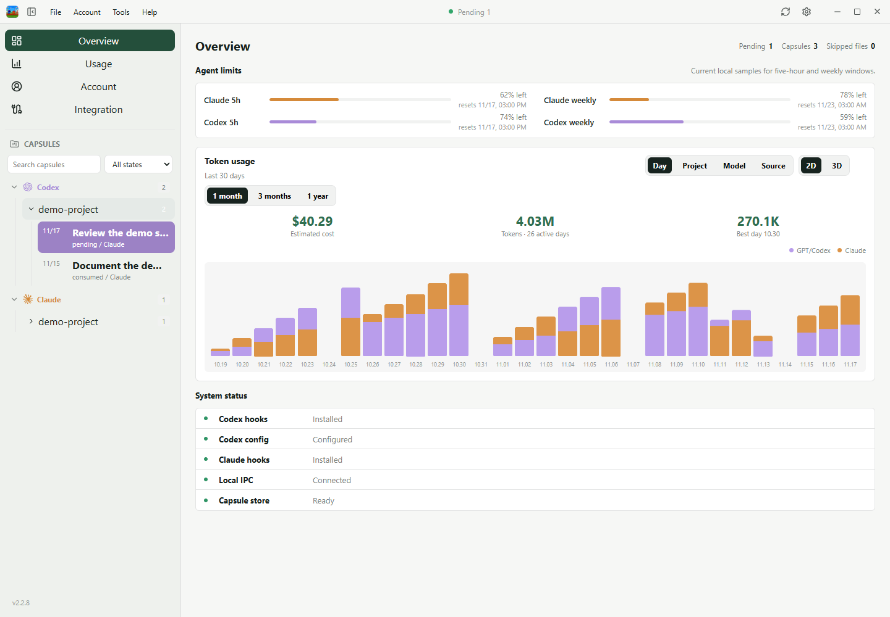
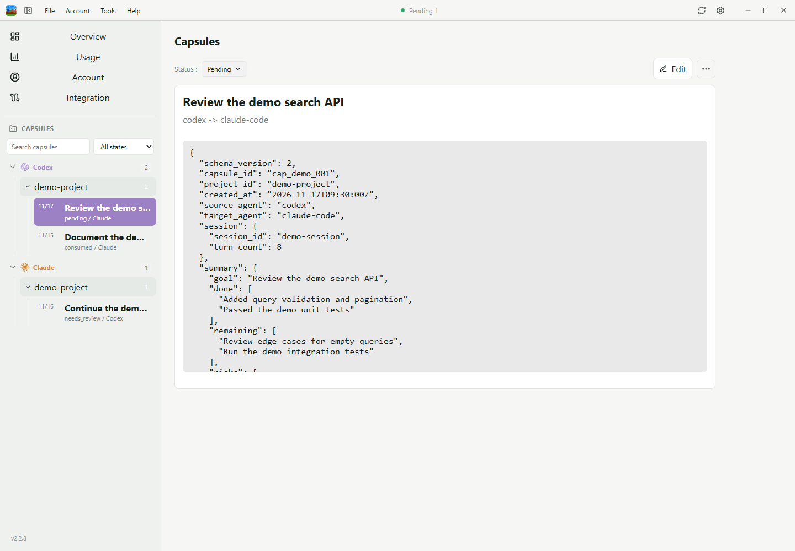
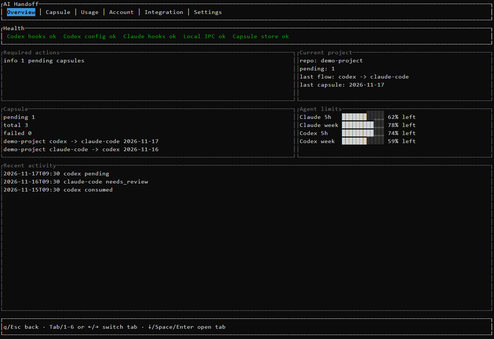
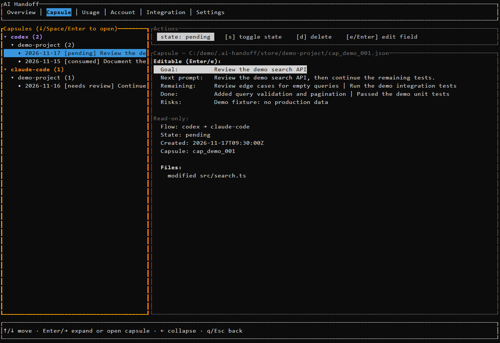
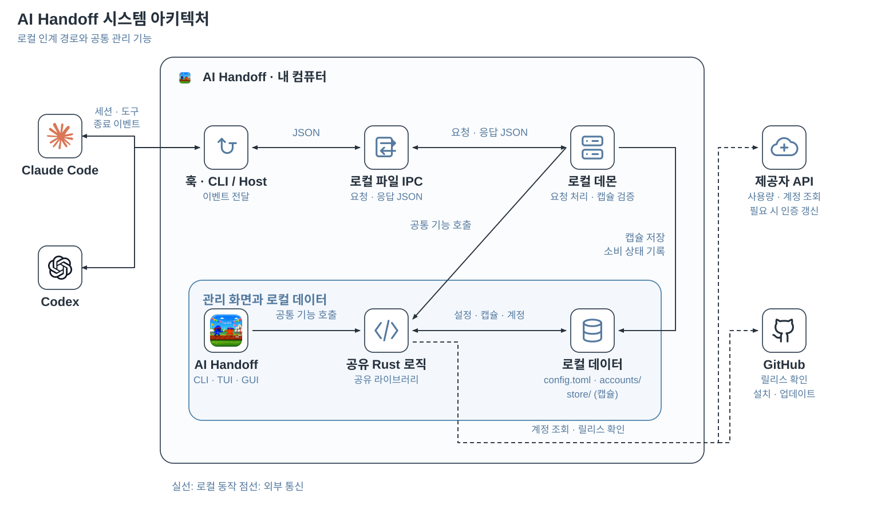
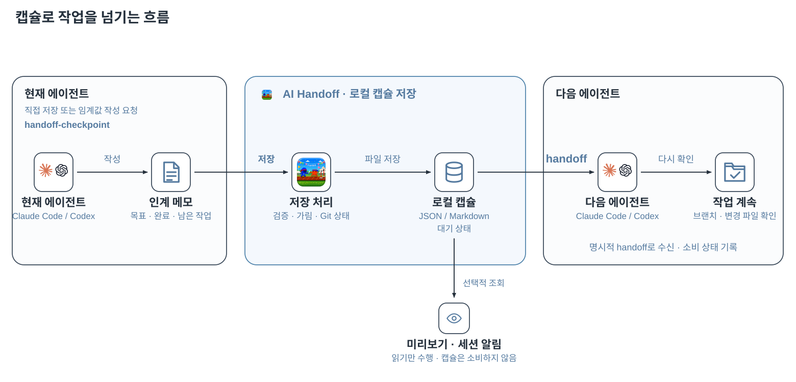

<div align="center">


# AI Handoff

**Claude Code와 Codex, 설명을 반복하지 않고 다음 작업으로.**

목표·완료한 일·남은 작업을 로컬 캡슐에 담아 다른 에이전트가 이어서 작업하도록 돕습니다.

**한국어** | [English](docs/README.en.md) | [日本語](docs/README.ja.md)

[](https://github.com/Lumisia/aho__ai-handoff/releases)
[](LICENSE)


[설치](#설치) · [사용 방법](#사용-방법) · [시스템 아키텍처](#시스템-아키텍처) · [AI Handoff 상세 문서](docs/advanced/README.md)

</div>

---

## 이런 문제를 풉니다

사용량 한도에 가까워지거나 작업 도구를 바꾸면, 다음 에이전트에게 목표와 진행 상황을 다시 설명해야 합니다. AI Handoff는 이 내용을 **캡슐이라는 인계 메모**로 남깁니다. 다음 에이전트는 같은 프로젝트에서 캡슐을 받아 완료한 일과 다음 할 일을 확인할 수 있습니다.

기본 설정에서는 5시간 사용량이 80%에 도달하면 체크포인트 작성을 물어봅니다. 저장 여부와 자동 작성 방식은 설정에서 바꿀 수 있으며, 언제든 직접 저장할 수도 있습니다.

## 핵심 기능

| 해시태그 | 기능 | 사용하는 곳 |
|---|---|---|
| `#작업 인계` | 목표·완료·남은 일·주의사항을 저장하고 다음 에이전트가 이어서 작업 | 에이전트 채팅의 저장·받기 스킬 |
| `#캡슐 관리` | 프로젝트별 인계 기록을 찾고 내용 확인·편집 | GUI 캡슐 트리 / TUI 캡슐 화면 |
| `#사용량 확인` | 로컬 로그 기반 토큰·비용 추정치를 기간과 프로젝트별로 확인 | GUI·TUI 사용량 화면 |
| `#계정 관리` | 저장한 계정의 전환과 제공자 한도 조회 | GUI·TUI 계정 화면 |
| `#연동 점검` | 훅·데몬·설치 상태를 진단하고 복구 방법 안내 | GUI·TUI 연동 화면 |

GUI는 마우스로 쓰는 데스크톱 앱, TUI는 터미널 안에서 키보드로 쓰는 화면입니다. 두 화면은 같은 로컬 설정과 캡슐을 사용합니다.

## 화면

아래는 **실제 GUI·TUI 화면에 가상 데이터를 넣어 만든 예시**입니다. 프로젝트·경로·사용량은 설명용이며 실제 사용자 계정이나 작업 기록을 사용하지 않았습니다. 이미지를 누르면 크게 볼 수 있습니다.

| GUI · 전체 상태 | GUI · 인계 메모 |
|:---:|:---:|
| [](docs/assets/readme/gui-overview.png) | [](docs/assets/readme/gui-capsules.png) |
| 개요에서 에이전트 상태와 사용량 추정치를 함께 확인합니다. | 왼쪽 프로젝트 트리에서 캡슐을 골라 목표와 남은 작업을 읽습니다. |

| TUI · 전체 상태 | TUI · 인계 메모 |
|:---:|:---:|
| [](docs/assets/readme/tui-overview.png) | [](docs/assets/readme/tui-capsules.png) |
| 연동 상태, 대기 캡슐, 가상 계정 한도 표본을 확인합니다. | 프로젝트별 캡슐에서 목표·완료·남은 작업과 하단 키 안내를 확인합니다. |

## 데이터를 다루는 원칙

- **캡슐과 훅 메시지는 로컬 파일에 저장·전달합니다.** 사용량·계정 확인은 제공자 API에 접속할 수 있고, 설치·업데이트는 GitHub에 접속합니다.
- **저장과 인계를 구분합니다.** 세션 시작 알림이나 미리보기는 캡슐을 소비하지 않습니다. `handoff` 스킬로 받아올 때 사용한 상태로 기록합니다.
- **추정치와 제공자 한도를 구분합니다.** 로컬 로그에서 계산한 토큰·비용은 공식 청구 금액이나 남은 한도가 아닙니다. 계정 화면의 한도 조회와 출처가 다릅니다.
- **비밀정보는 인계 메모에 넣지 않습니다.** 비밀번호·API 키·인증 토큰·원문 대화 기록을 넣지 마세요. 자동 가림 처리가 모든 비밀정보를 찾아낸다고 보장하지 않습니다.

## 저장하는 데이터

| 데이터 | 쓰임 | 저장 위치 |
|---|---|---|
| 캡슐 | 목표, 완료·남은 일, 위험 요소, 다음 작업 지시, Git 상태 | 로컬 `store/` |
| 공통 설정 | 언어, 테마, 사용량 기준, 캡슐 작성 방식 | 로컬 `config.toml` |
| 훅 요청·응답 | 에이전트 이벤트와 데몬 사이 메시지 전달 | 로컬 `ipc/` |
| 사용량 추정 | Claude Code·Codex의 로컬 로그를 읽어 집계 | 각 도구의 로컬 로그 |

운영체제별 경로와 계정 저장소는 [AI Handoff 상세 문서](docs/advanced/README.md)에서 설명합니다.

## 기술 스택

| 영역 | 사용 기술 |
|---|---|
| CLI · 공통 로직 · 데몬 | Rust |
| 터미널 화면 | Ratatui, Crossterm |
| 데스크톱 화면 | Tauri 2, React 18, TypeScript, Vite |
| 캡슐 · 설정 · 통신 | JSON / Markdown, TOML, 로컬 파일 IPC |
| 검증 · 배포 | Cargo test, Node.js test runner, GitHub Actions |

## 시스템 아키텍처

[](docs/assets/readme/architecture.ko.svg)

훅은 에이전트의 작업 이벤트를 전달하는 연결 장치이고, 데몬은 요청을 처리하는 로컬 백그라운드 프로그램입니다. 공유 Rust 로직은 별도 서버가 아닌 라이브러리이며, 데몬과 CLI·TUI·GUI가 함께 사용합니다. 그림의 점선은 제공자 API 및 GitHub로 나가는 통신을 나타냅니다.

### 캡슐로 작업을 넘기는 흐름

[](docs/assets/readme/handoff-flow.ko.svg)

자동 임계값 감지는 현재 에이전트에게 **인계 메모 작성을 요청**합니다. 전체 대화가 그대로 복사되는 방식이 아닙니다. 받는 에이전트는 캡슐을 읽은 뒤 실제 브랜치와 변경 파일도 다시 확인해야 합니다. 두 그림은 Codex가 현재 소스 구조에 맞춰 작성한 SVG입니다.

## 프로젝트 구조

```text
ai-handoff/
├── crates/
│   ├── ai-handoff-cli/       명령어와 훅 진입점
│   ├── ai-handoff-core/      공통 설정·캡슐·설치·계정 로직
│   ├── ai-handoff-daemon/    이벤트 처리와 캡슐 저장
│   ├── ai-handoff-ipc/       로컬 파일 통신
│   ├── ai-handoff-tui/       터미널 화면
│   └── ai-handoff-usage/     사용량 로그 분석
├── apps/desktop/             데스크톱 앱
├── skills/                   에이전트용 인계 명령
└── docs/                     다국어 안내와 상세 문서
```

## 설치

Claude Code 또는 Codex를 먼저 설치하고 **한 번 실행해 초기 설정 폴더를 만든 뒤** 설치하세요. AI Handoff 릴리스 설치에는 Node.js나 Rust가 필요하지 않습니다.

### [공식 릴리스에서 다운로드](https://github.com/Lumisia/aho__ai-handoff/releases)

릴리스의 **Assets**를 펼쳐 운영체제와 CPU에 맞는 파일을 고르세요.

| 환경 | 다운로드할 파일 | 포함된 화면 |
|---|---|---|
| Windows x64 · 권장 | `ai-handoff-gui-windows-x86_64-setup.exe` | GUI + CLI/TUI |
| Windows ARM64 · 권장 | `ai-handoff-gui-windows-aarch64-setup.exe` | GUI + CLI/TUI |
| macOS · Apple Silicon | `ai-handoff-cli-darwin-aarch64.tar.gz` | CLI/TUI |
| macOS · Intel | `ai-handoff-cli-darwin-x86_64.tar.gz` | CLI/TUI |
| Linux x64 | `ai-handoff-cli-linux-x86_64.tar.gz` | CLI/TUI |
| Linux ARM64 | `ai-handoff-cli-linux-aarch64.tar.gz` | CLI/TUI |

**Windows:** 내려받은 `-setup.exe`를 실행합니다. CLI/TUI도 함께 설치되며, 설치 후 시작 메뉴에서 **aho** 또는 **AI Handoff**를 검색해 GUI를 엽니다.

**macOS·Linux:** 압축을 풀고 CLI와 호스트 파일을 같은 폴더에 둡니다. PATH와 에이전트 연동 등록은 [CLI 수동 설치 안내](docs/advanced/README.md#설치-옵션)를 따라 완료하세요. WSL에서는 Linux용 파일을 고르고, Windows GUI는 Windows에서 설치합니다.

Windows 설치기는 현재 서명되어 있지 않아 SmartScreen 경고가 나올 수 있습니다. SHA-256 확인 방법, Windows CLI/TUI 전용 파일, 설치 스크립트와 버전 지정은 [설치 옵션](docs/advanced/README.md#설치-옵션)을 참고하세요.

### 설치 후 한 번만

1. Claude Code와 Codex를 다시 시작합니다.
2. Codex의 `/hooks`에서 AI Handoff 훅을 신뢰 처리합니다.
3. 터미널에서 아래 명령으로 설치 상태를 확인합니다.

```sh
ai-handoff doctor
```

## 사용 방법

### 다른 에이전트에게 작업 넘기기

1. **현재 에이전트 채팅**의 스킬 목록에서 AI Handoff의 **`handoff-checkpoint`(저장)**를 선택해 목표·진행 상황·남은 일을 저장합니다.
2. **다음 에이전트에서 같은 프로젝트 폴더**를 엽니다.
3. 그 에이전트 채팅에서 AI Handoff의 **`handoff`(받기)**를 선택하고 이어서 할 일을 요청합니다.

플러그인 스킬 목록에는 `ai-handoff:handoff-checkpoint`, `ai-handoff:handoff`로 표시됩니다. 터미널 명령과 구분해 사용하세요. 스킬이 보이지 않거나 옵션이 필요하면 [명령어 참조](docs/advanced/README.md#명령어-참조)를 확인하세요.

### GUI · 마우스로 사용하기

시작 메뉴에서 앱을 연 뒤 왼쪽 메뉴를 선택합니다. 앱 기본 언어는 영어이며, 오른쪽 위 **톱니 아이콘 → Language**에서 한국어·영어·일본어를 선택할 수 있습니다.

| 하고 싶은 일 | 누르는 곳 |
|---|---|
| 전체 상태 확인 | **개요 / Overview** |
| 저장한 인계 메모 읽기 | 왼쪽 캡슐 트리에서 **에이전트 → 프로젝트 → 캡슐** |
| 토큰·비용 추정치 확인 | **사용량 / Usage** |
| 계정 추가·전환·한도 조회 | **계정 / Account** |
| 설치나 훅 문제 점검 | **연동 / Integration → 진단 실행** |
| 언어·테마·작성 기준 변경 | 오른쪽 위 **톱니 아이콘** |

### TUI · 터미널에서 사용하기

터미널에서 `aho` 또는 `ai-handoff`를 실행하면 TUI가 열립니다. `aho`는 Windows 설치가 제공하는 단축 명령이며, 다른 환경에서는 `ai-handoff`를 사용하세요.

```sh
ai-handoff
```

| 순서 | 조작 |
|---|---|
| 1. 화면 고르기 | `1`–`6` 또는 `Tab`으로 개요·캡슐·사용량·계정·연동·설정 선택 |
| 2. 내용 살펴보기 | `Enter` 또는 `↓`로 내용에 들어간 뒤 화면 아래 키 안내에 따라 조작 |
| 3. 돌아가기·종료 | `q` 또는 `Esc`로 탭 선택 상태로 복귀. 탭 선택 상태에서 두 번 누르면 종료 |

Windows 시작 메뉴의 **aho** 바로가기는 GUI 앱을 엽니다.

## AI Handoff 상세 문서

기본 사용 이후에 필요한 설명은 아래 문서에 모았습니다.

- [전체 명령어·옵션·설정](docs/advanced/README.md#명령어-참조)
- [설치 옵션·업데이트·제거](docs/advanced/README.md#설치-옵션)
- [개발 환경·소스 빌드·테스트](docs/advanced/README.md#개발)
- [문제 해결](docs/advanced/README.md#문제-해결)

## 라이선스

[MIT](LICENSE)
