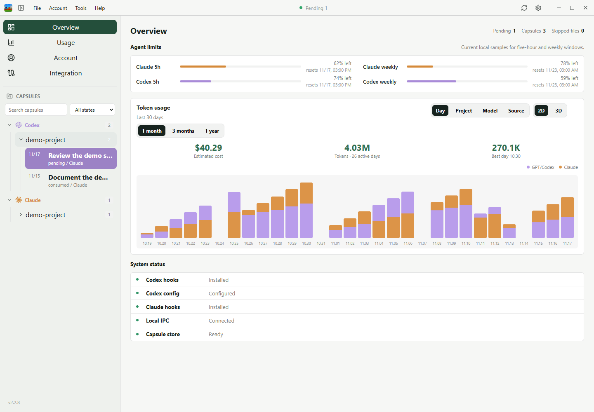
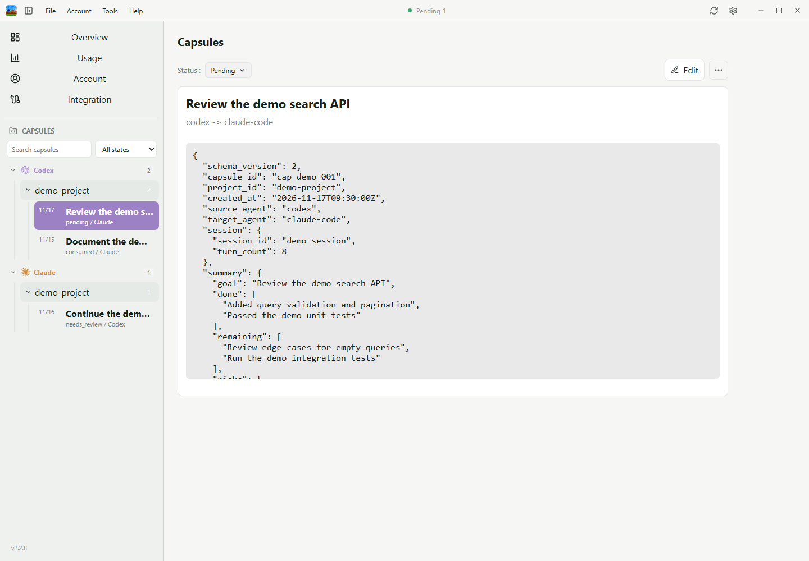
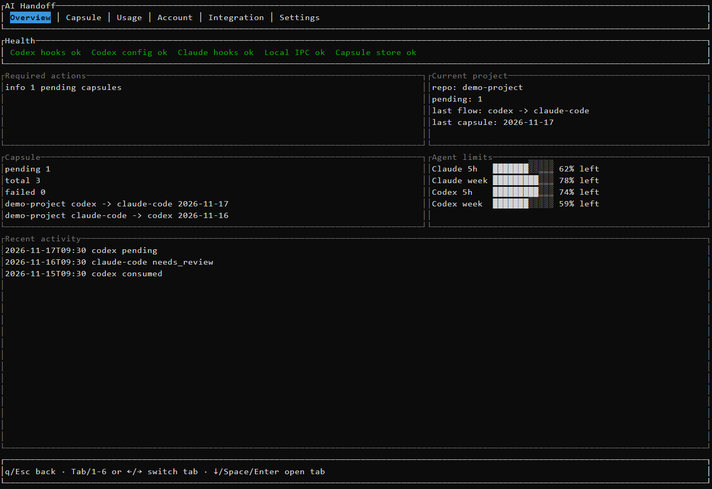
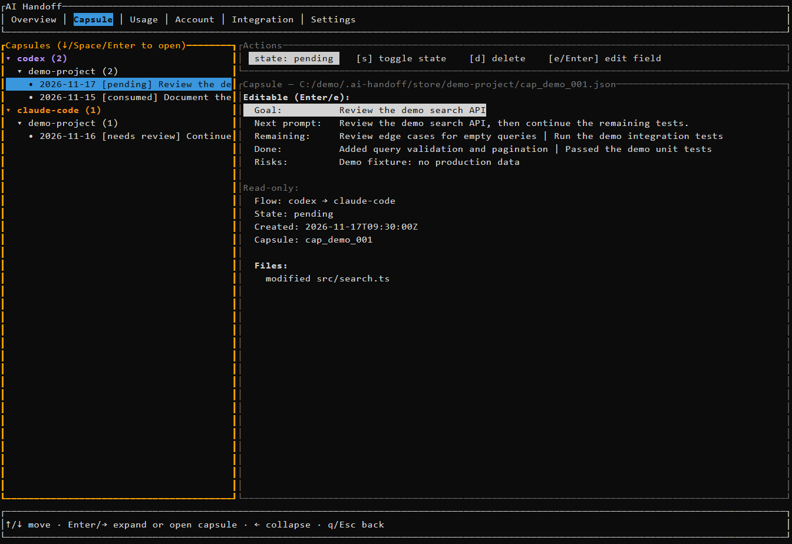
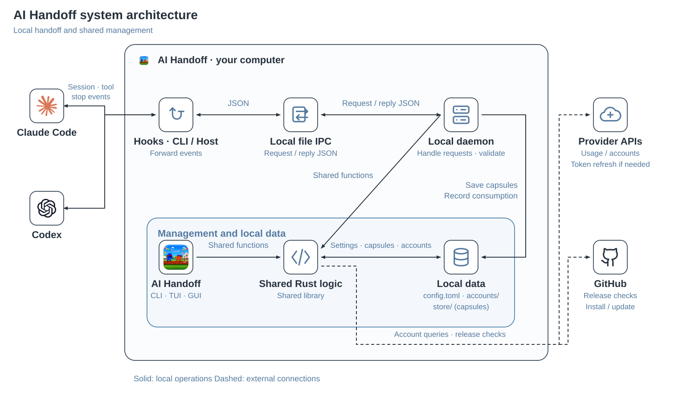
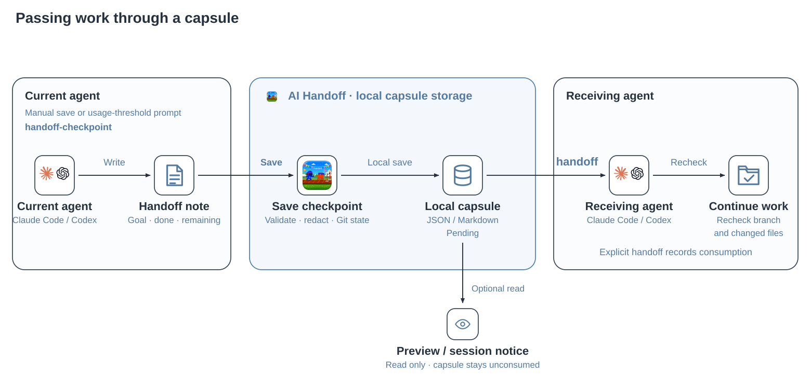

<div align="center">


# AI Handoff

**Move between Claude Code and Codex without explaining your work all over again.**

Save your goal, completed work, and next steps in a local capsule so another agent can continue.

[한국어](../README.md) | **English** | [日本語](README.ja.md)

[](https://github.com/Lumisia/aho__ai-handoff/releases)
[](../LICENSE)


[Installation](#installation) · [Usage](#usage) · [System architecture](#system-architecture) · [AI Handoff advanced guide](advanced/README.en.md)

</div>

---

## The problem it solves

When you approach a usage limit or change tools, you have to explain your goal and progress to the next agent again. AI Handoff saves this context in a **handoff note called a capsule**. The next agent can retrieve it in the same project to see what is done and what comes next.

By default, AI Handoff asks about creating a checkpoint when five-hour usage reaches 80%. You can change whether to save and how automatic creation works in settings, or save a checkpoint manually at any time.

## Key features

| Hashtag | Feature | Where to use it |
|---|---|---|
| `#Handoff` | Save the goal, completed work, remaining tasks, and cautions for the next agent | Save and receive skills in the agent chat |
| `#Capsules` | Find, read, and edit handoff records by project | GUI capsule tree / TUI capsule screen |
| `#Usage` | View token and cost estimates from local logs by period and project | GUI and TUI usage screens |
| `#Accounts` | Switch saved accounts and query provider limits | GUI and TUI account screens |
| `#Integration` | Diagnose hooks, the daemon, and installation status, with repair guidance | GUI and TUI integration screens |

The GUI is a desktop app you use with a mouse. The TUI is a screen inside your terminal that you use with a keyboard. Both use the same local settings and capsules.

## Screenshots

These examples show the **actual GUI and TUI rendered with fictional data**. Projects, paths, and usage values are for illustration; no real user accounts or work records were used. Click an image to enlarge it.

| GUI · Overall status | GUI · Handoff note |
|:---:|:---:|
| [](assets/readme/gui-overview.png) | [](assets/readme/gui-capsules.png) |
| Check agent status and usage estimates together in Overview. | Select a capsule in the project tree on the left to read its goal and remaining tasks. |

| TUI · Overall status | TUI · Handoff note |
|:---:|:---:|
| [](assets/readme/tui-overview.png) | [](assets/readme/tui-capsules.png) |
| Check integration health, pending capsules, and fictional account-limit samples. | Read the goal, completed work, remaining tasks, and footer key hints for each project's capsules. |

## Data handling principles

- **Capsules and hook messages are stored and passed through local files.** Usage and account checks may connect to provider APIs. Installation and updates connect to GitHub.
- **Saving and receiving a handoff are separate actions.** Session-start notifications and previews do not consume capsules. A capsule is marked as consumed when you retrieve it with the `handoff` skill.
- **Estimates and provider limits are different.** Token and cost values calculated from local logs are not official charges or remaining limits. They have a different source from limit queries on the Account screen.
- **Keep secrets out of handoff notes.** Do not include passwords, API keys, authentication tokens, or raw conversation logs. Automatic redaction is not guaranteed to find every secret.

## Stored data

| Data | Purpose | Location |
|---|---|---|
| Capsules | Goal, completed and remaining work, risks, next instructions, and Git state | Local `store/` |
| Shared settings | Language, theme, usage thresholds, and capsule creation behavior | Local `config.toml` |
| Hook requests and responses | Pass messages between agent events and the daemon | Local `ipc/` |
| Usage estimates | Read and aggregate local Claude Code and Codex logs | Each tool's local logs |

The [AI Handoff advanced guide](advanced/README.en.md) explains OS-specific paths and account storage.

## Technology stack

| Area | Technologies |
|---|---|
| CLI, shared logic, daemon | Rust |
| Terminal interface | Ratatui, Crossterm |
| Desktop interface | Tauri 2, React 18, TypeScript, Vite |
| Capsules, settings, communication | JSON / Markdown, TOML, local file IPC |
| Verification and releases | Cargo test, Node.js test runner, GitHub Actions |

## System architecture

[](assets/readme/architecture.en.svg)

Hooks relay agent events, and the daemon is a local background program that handles requests. Shared Rust logic is a library, rather than a separate server, used by the daemon, CLI, TUI, and GUI. Dashed lines in the diagram show outgoing connections to provider APIs and GitHub.

### Passing work through a capsule

[](assets/readme/handoff-flow.en.svg)

Automatic threshold detection **asks the current agent to write a handoff note**. It does not copy the entire conversation. After reading the capsule, the receiving agent must also check the actual branch and changed files again. Both diagrams are SVGs created by Codex to reflect the current source structure.

## Project structure

```text
ai-handoff/
├── crates/
│   ├── ai-handoff-cli/       Commands and hook entry points
│   ├── ai-handoff-core/      Shared settings, capsules, installation, and accounts
│   ├── ai-handoff-daemon/    Event handling and capsule storage
│   ├── ai-handoff-ipc/       Local file communication
│   ├── ai-handoff-tui/       Terminal interface
│   └── ai-handoff-usage/     Usage log analysis
├── apps/desktop/             Desktop app
├── skills/                   Agent handoff commands
└── docs/                     Multilingual guides and detailed documentation
```

## Installation

Install Claude Code or Codex first and **launch it once to create its initial configuration folder**. Installing an AI Handoff release does not require Node.js or Rust.

### [Download from official releases](https://github.com/Lumisia/aho__ai-handoff/releases)

Expand **Assets** on the release and choose the file for your operating system and CPU.

| Environment | File to download | Included interfaces |
|---|---|---|
| Windows x64 · Recommended | `ai-handoff-gui-windows-x86_64-setup.exe` | GUI + CLI/TUI |
| Windows ARM64 · Recommended | `ai-handoff-gui-windows-aarch64-setup.exe` | GUI + CLI/TUI |
| macOS · Apple Silicon | `ai-handoff-cli-darwin-aarch64.tar.gz` | CLI/TUI |
| macOS · Intel | `ai-handoff-cli-darwin-x86_64.tar.gz` | CLI/TUI |
| Linux x64 | `ai-handoff-cli-linux-x86_64.tar.gz` | CLI/TUI |
| Linux ARM64 | `ai-handoff-cli-linux-aarch64.tar.gz` | CLI/TUI |

**Windows:** Run the downloaded `-setup.exe`. It also installs CLI/TUI. After installation, search for **aho** or **AI Handoff** in the Start menu to open the GUI.

**macOS and Linux:** Extract the archive and keep the CLI and host files in the same folder. Complete PATH setup and agent integration using the [manual CLI installation guide](advanced/README.en.md#installation-options). For WSL, choose a Linux file; install the Windows GUI from Windows.

The Windows installer is currently unsigned, so SmartScreen may show a warning. See [installation options](advanced/README.en.md#installation-options) for SHA-256 verification, Windows CLI/TUI-only files, installer scripts, and version selection.

### Once after installation

1. Restart Claude Code and Codex.
2. Trust the AI Handoff hooks in Codex's `/hooks` screen.
3. Check the installation in a terminal with this command.

```sh
ai-handoff doctor
```

## Usage

### Pass work to another agent

1. In the skill list of the **current agent's chat**, select AI Handoff's **`handoff-checkpoint` (save)** to save the goal, progress, and remaining tasks.
2. Open the **same project folder in the next agent**.
3. In that agent's chat, select AI Handoff's **`handoff` (receive)** and ask it to continue.

The plugin skill list shows them as `ai-handoff:handoff-checkpoint` and `ai-handoff:handoff`. Use them separately from terminal commands. If the skills are missing or you need options, see the [command reference](advanced/README.en.md#command-reference).

### GUI · Use with a mouse

Open the app from the Start menu, then choose an item on the left. The app defaults to English. To choose Korean, English, or Japanese, click the **gear icon at the top right → Language**.

| What you want to do | Where to click |
|---|---|
| Check overall status | **Overview** |
| Read a saved handoff note | **Agent → Project → Capsule** in the capsule tree on the left |
| Check token and cost estimates | **Usage** |
| Add or switch accounts and query limits | **Account** |
| Check installation or hook problems | **Integration → Run doctor** |
| Change language, theme, or creation settings | **Gear icon at the top right** |

### TUI · Use inside a terminal

Run `aho` or `ai-handoff` in a terminal to open the TUI. Windows installations provide `aho` as a shortcut; use `ai-handoff` on other platforms.

```sh
ai-handoff
```

| Step | Controls |
|---|---|
| 1. Choose a screen | Use `1`–`6` or `Tab` to select Overview, Capsule, Usage, Account, Integration, or Settings |
| 2. Explore the contents | Press `Enter` or `↓` to enter the content area, then follow the key hints at the bottom |
| 3. Go back or quit | Use `q` or `Esc` to return to the tab bar. Press it twice at the tab bar to quit |

The **aho** shortcut in the Windows Start menu opens the GUI app.

## AI Handoff advanced guide

These documents cover what you may need after the basics.

- [All commands, options, and settings](advanced/README.en.md#command-reference)
- [Installation options, updates, and removal](advanced/README.en.md#installation-options)
- [Development environment, source builds, and tests](advanced/README.en.md#development)
- [Troubleshooting](advanced/README.en.md#troubleshooting)

## License

[MIT](../LICENSE)
