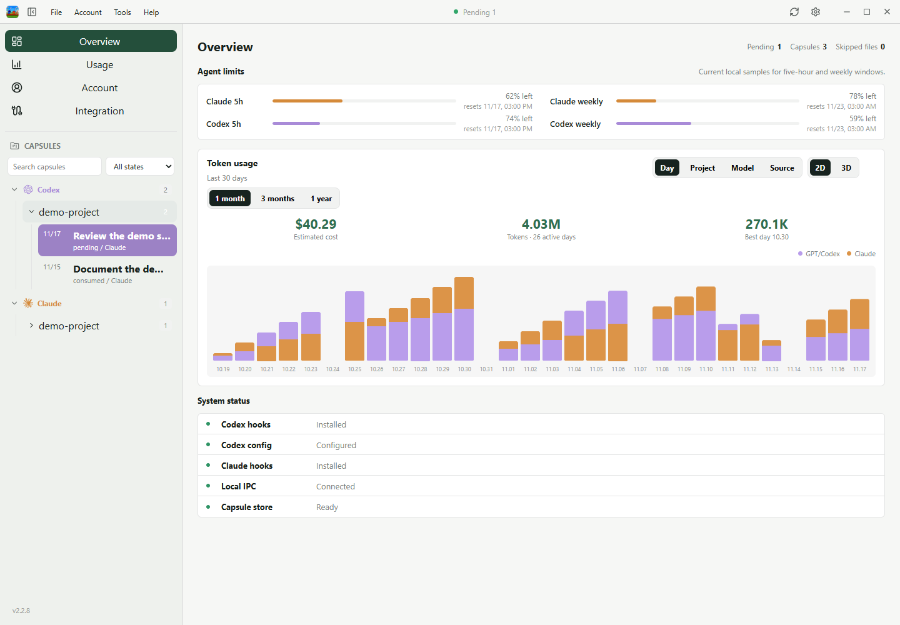
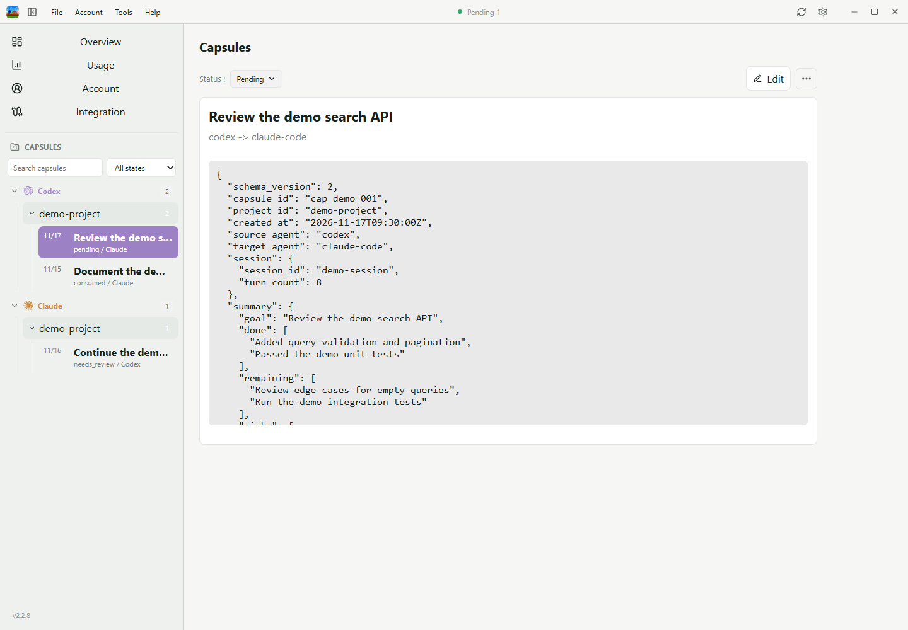
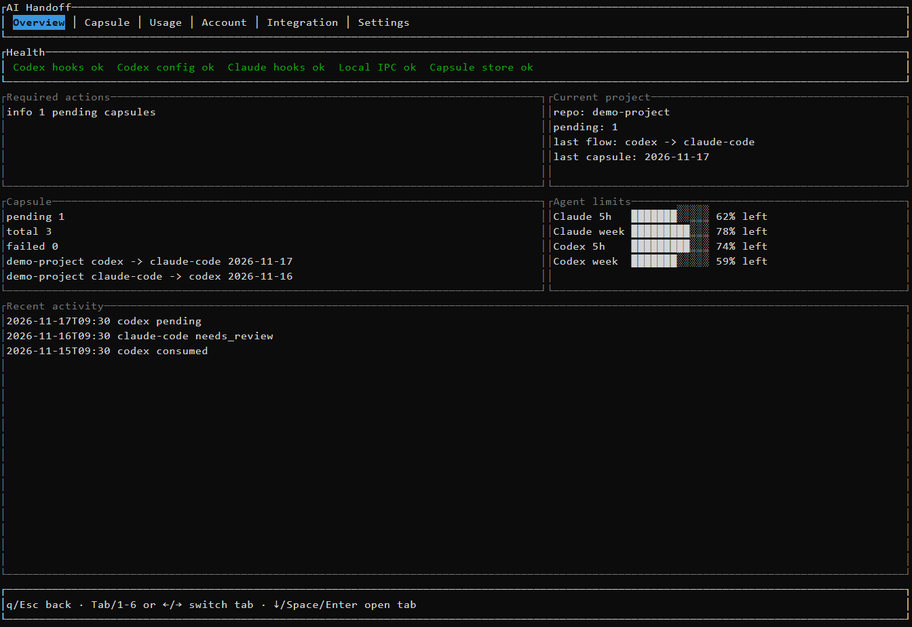
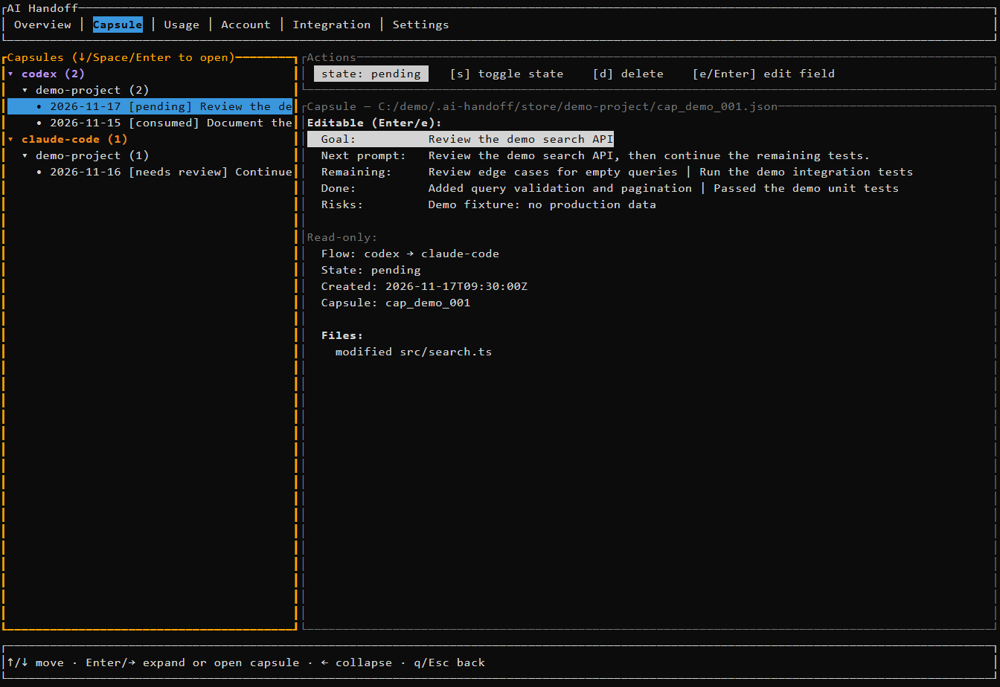
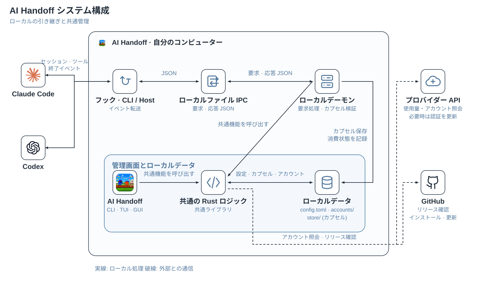
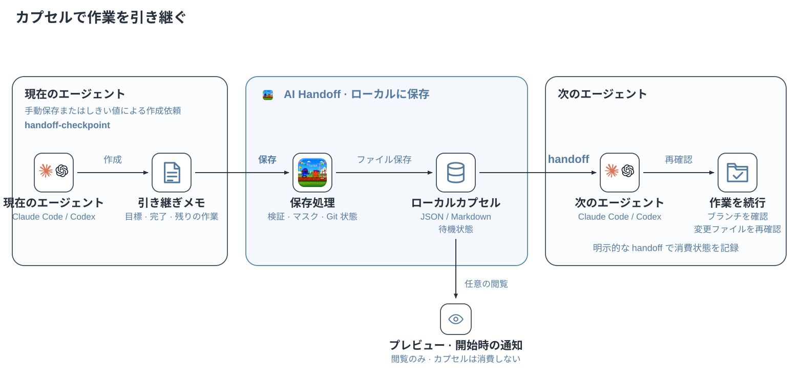

<div align="center">


# AI Handoff

**Claude Code と Codex、同じ説明を繰り返さずに次の作業へ。**

目標・完了したこと・残りの作業をローカルのカプセルにまとめ、別のエージェントが作業を続けられるようにします。

[한국어](../README.md) | [English](README.en.md) | **日本語**

[](https://github.com/Lumisia/aho__ai-handoff/releases)
[](../LICENSE)


[インストール](#インストール) · [使い方](#使い方) · [システム構成](#システム構成) · [AI Handoff 詳細ガイド](advanced/README.ja.md)

</div>

---

## こんな問題を解決します

使用量の上限に近づいたり、作業に使うツールを変えたりすると、次のエージェントに目標と進捗を説明し直す必要があります。AI Handoff は、この情報を**カプセルという引き継ぎメモ**として残します。次のエージェントは同じプロジェクトでカプセルを受け取り、完了したことと次にやることを確認できます。

初期設定では、5時間の使用量が80%に達すると、チェックポイントを作成するか確認します。保存するかどうかや自動作成の方法は設定で変更でき、いつでも手動で保存できます。

## 主な機能

| ハッシュタグ | 機能 | 使う場所 |
|---|---|---|
| `#作業の引き継ぎ` | 目標・完了したこと・残りの作業・注意事項を保存し、次のエージェントが作業を継続 | エージェントのチャットにある保存・受け取り用スキル |
| `#カプセル管理` | プロジェクト別の引き継ぎ記録を探し、内容を確認・編集 | GUI のカプセルツリー / TUI のカプセル画面 |
| `#使用量の確認` | ローカルログに基づくトークン数・費用の推定値を期間やプロジェクト別に確認 | GUI・TUI の使用量画面 |
| `#アカウント管理` | 保存したアカウントの切り替えと、提供元の上限情報の取得 | GUI・TUI のアカウント画面 |
| `#連携の診断` | フック・デーモン・インストール状態を診断し、修復方法を案内 | GUI・TUI の連携画面 |

GUI はマウスで使うデスクトップアプリ、TUI はターミナル内でキーボードを使って操作する画面です。どちらも同じローカル設定とカプセルを使います。

## 画面

以下は、**実際の GUI・TUI に架空のデータを入れて描画した例**です。プロジェクト・パス・使用量は説明用であり、実際のユーザーアカウントや作業記録は使用していません。画像をクリックすると拡大できます。

| GUI · 全体の状態 | GUI · 引き継ぎメモ |
|:---:|:---:|
| [](assets/readme/gui-overview.png) | [](assets/readme/gui-capsules.png) |
| 概要画面でエージェントの状態と使用量の推定値をまとめて確認できます。 | 左側のプロジェクトツリーでカプセルを選び、目標と残りの作業を読みます。 |

| TUI · 全体の状態 | TUI · 引き継ぎメモ |
|:---:|:---:|
| [](assets/readme/tui-overview.png) | [](assets/readme/tui-capsules.png) |
| 連携状態、待機カプセル、架空のアカウント上限サンプルを確認できます。 | プロジェクト別カプセルの目標・完了・残りの作業と、画面下部のキー案内を確認できます。 |

## データの取り扱い方針

- **カプセルとフックのメッセージは、ローカルファイルに保存して受け渡します。** 使用量やアカウントの確認では提供元の API に接続する場合があり、インストール・更新では GitHub に接続します。
- **保存と引き継ぎの受け取りを分けています。** セッション開始時の通知やプレビューでは、カプセルを消費しません。`handoff` スキルで受け取ったときに、使用済みとして記録します。
- **推定値と提供元の上限情報を区別します。** ローカルログから計算したトークン数・費用は、正式な請求額や残りの利用可能量ではありません。アカウント画面で取得する上限情報とは情報源が異なります。
- **引き継ぎメモに秘密情報を入れないでください。** パスワード・API キー・認証トークン・会話ログの原文は含めないでください。自動マスキングがすべての秘密情報を検出できる保証はありません。

## 保存するデータ

| データ | 用途 | 保存場所 |
|---|---|---|
| カプセル | 目標、完了・残りの作業、リスク、次の作業指示、Git の状態 | ローカルの `store/` |
| 共通設定 | 言語、テーマ、使用量のしきい値、カプセルの作成方法 | ローカルの `config.toml` |
| フックのリクエスト・レスポンス | エージェントのイベントとデーモンの間でメッセージを受け渡す | ローカルの `ipc/` |
| 使用量の推定 | Claude Code・Codex のローカルログを読み込んで集計 | 各ツールのローカルログ |

OS ごとのパスとアカウントの保存領域については、[AI Handoff 詳細ガイド](advanced/README.ja.md)で説明しています。

## 技術スタック

| 領域 | 使用技術 |
|---|---|
| CLI・共通ロジック・デーモン | Rust |
| ターミナル画面 | Ratatui, Crossterm |
| デスクトップ画面 | Tauri 2, React 18, TypeScript, Vite |
| カプセル・設定・通信 | JSON / Markdown, TOML, ローカルファイル IPC |
| 検証・リリース | Cargo test, Node.js test runner, GitHub Actions |

## システム構成

[](assets/readme/architecture.ja.svg)

フックはエージェントの作業イベントを受け渡す仕組みで、デーモンはリクエストを処理するローカルのバックグラウンドプログラムです。共通の Rust ロジックは別のサーバーではなくライブラリで、デーモンと CLI・TUI・GUI が利用します。図の点線は、提供元の API と GitHub への通信を表します。

### カプセルで作業を引き継ぐ流れ

[](assets/readme/handoff-flow.ja.svg)

しきい値の自動検出では、現在のエージェントに**引き継ぎメモの作成を依頼**します。会話全体をそのままコピーする仕組みではありません。受け取るエージェントは、カプセルを読んだ後に実際のブランチと変更ファイルも確認し直す必要があります。2つの図は、現在のソース構成に合わせて Codex が作成した SVG です。

## プロジェクト構成

```text
ai-handoff/
├── crates/
│   ├── ai-handoff-cli/       コマンドとフックのエントリーポイント
│   ├── ai-handoff-core/      共通設定・カプセル・インストール・アカウントのロジック
│   ├── ai-handoff-daemon/    イベント処理とカプセルの保存
│   ├── ai-handoff-ipc/       ローカルファイル通信
│   ├── ai-handoff-tui/       ターミナル画面
│   └── ai-handoff-usage/     使用量ログの解析
├── apps/desktop/             デスクトップアプリ
├── skills/                   エージェント用の引き継ぎコマンド
└── docs/                     多言語ガイドと詳細ドキュメント
```

## インストール

先に Claude Code または Codex をインストールし、**一度起動して初期設定フォルダーを作成してから** AI Handoff をインストールしてください。AI Handoff のリリース版のインストールに Node.js や Rust は必要ありません。

### [公式リリースからダウンロード](https://github.com/Lumisia/aho__ai-handoff/releases)

リリースの **Assets** を展開し、OS と CPU に合うファイルを選んでください。

| 環境 | ダウンロードするファイル | 含まれる画面 |
|---|---|---|
| Windows x64 · 推奨 | `ai-handoff-gui-windows-x86_64-setup.exe` | GUI + CLI/TUI |
| Windows ARM64 · 推奨 | `ai-handoff-gui-windows-aarch64-setup.exe` | GUI + CLI/TUI |
| macOS · Apple Silicon | `ai-handoff-cli-darwin-aarch64.tar.gz` | CLI/TUI |
| macOS · Intel | `ai-handoff-cli-darwin-x86_64.tar.gz` | CLI/TUI |
| Linux x64 | `ai-handoff-cli-linux-x86_64.tar.gz` | CLI/TUI |
| Linux ARM64 | `ai-handoff-cli-linux-aarch64.tar.gz` | CLI/TUI |

**Windows:** ダウンロードした `-setup.exe` を実行します。CLI/TUI も一緒にインストールされます。インストール後、スタートメニューで **aho** または **AI Handoff** を検索して GUI を開きます。

**macOS・Linux:** アーカイブを展開し、CLI とホストのファイルを同じフォルダーに置きます。PATH の設定とエージェント連携の登録は、[CLI の手動インストールガイド](advanced/README.ja.md#インストールオプション)に従って完了してください。WSL では Linux 用のファイルを選び、Windows GUI は Windows 側でインストールします。

Windows インストーラーは現在未署名のため、SmartScreen の警告が表示される場合があります。SHA-256 の確認方法、Windows の CLI/TUI 専用ファイル、インストールスクリプト、バージョン指定については、[インストールオプション](advanced/README.ja.md#インストールオプション)を参照してください。

### インストール後に一度だけ

1. Claude Code と Codex を再起動します。
2. Codex の `/hooks` 画面で AI Handoff のフックを信頼する設定にします。
3. ターミナルで次のコマンドを実行し、インストール状態を確認します。

```sh
ai-handoff doctor
```

## 使い方

### 別のエージェントに作業を引き継ぐ

1. **現在のエージェントのチャット**のスキル一覧から、AI Handoff の **`handoff-checkpoint`（保存）**を選び、目標・進捗・残りの作業を保存します。
2. **次のエージェントで同じプロジェクトフォルダー**を開きます。
3. そのエージェントのチャットで AI Handoff の **`handoff`（受け取り）**を選び、続きの作業を依頼します。

プラグインのスキル一覧には `ai-handoff:handoff-checkpoint`、`ai-handoff:handoff` と表示されます。ターミナルのコマンドとは区別して使ってください。スキルが見つからない場合やオプションが必要な場合は、[コマンドリファレンス](advanced/README.ja.md#コマンドリファレンス)を確認してください。

### GUI · マウスで使う

スタートメニューからアプリを開き、左側のメニューを選びます。アプリの初期言語は英語です。右上の**歯車アイコン → Language**で、韓国語・英語・日本語を選べます。

| やりたいこと | クリックする場所 |
|---|---|
| 全体の状態を確認 | **概要 / Overview** |
| 保存した引き継ぎメモを読む | 左側のカプセルツリーで **エージェント → プロジェクト → カプセル** |
| トークン数・費用の推定値を確認 | **使用量 / Usage** |
| アカウントの追加・切り替え・上限情報の取得 | **アカウント / Account** |
| インストールやフックの問題を確認 | **連携 / Integration → 診断を実行** |
| 言語・テーマ・作成基準を変更 | 右上の**歯車アイコン** |

### TUI · ターミナルで使う

ターミナルで `aho` または `ai-handoff` を実行すると TUI が開きます。`aho` は Windows のインストールで用意される短縮コマンドです。他の環境では `ai-handoff` を使ってください。

```sh
ai-handoff
```

| 手順 | 操作 |
|---|---|
| 1. 画面を選ぶ | `1`–`6` または `Tab` で、概要・カプセル・使用量・アカウント・連携・設定を選択 |
| 2. 内容を見る | `Enter` または `↓` で内容に入り、画面下のキー案内に従って操作 |
| 3. 戻る・終了する | `q` または `Esc` でタブ選択に戻る。タブ選択の状態で2回押すと終了 |

Windows のスタートメニューにある **aho** のショートカットは GUI アプリを開きます。

## AI Handoff 詳細ガイド

基本操作の後に必要になる説明は、以下のドキュメントにまとめています。

- [すべてのコマンド・オプション・設定](advanced/README.ja.md#コマンドリファレンス)
- [インストールオプション・更新・アンインストール](advanced/README.ja.md#インストールオプション)
- [開発環境・ソースビルド・テスト](advanced/README.ja.md#開発)
- [トラブルシューティング](advanced/README.ja.md#トラブルシューティング)

## ライセンス

[MIT](../LICENSE)
